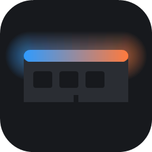
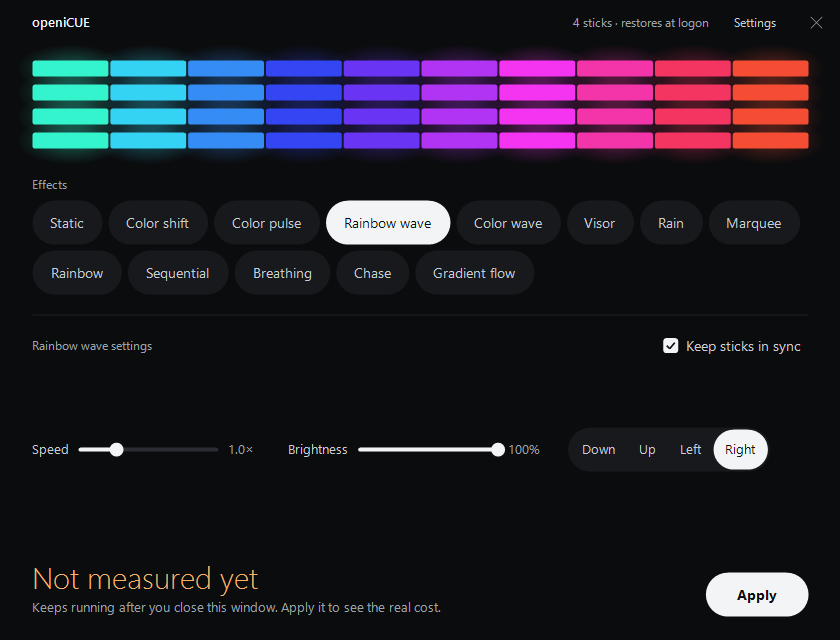
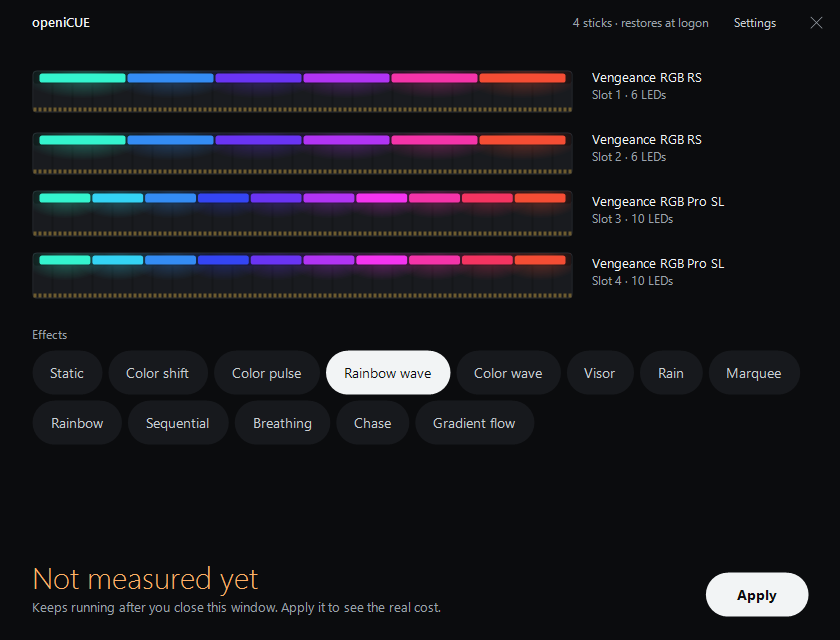

<div align="center">



# openiCUE

**A tiny, open-source lighting controller for Corsair Vengeance RGB Pro, Pro SL and RS memory on Windows.**

No account, no tray icon, no background bloat: pick an effect, press Apply, close the window.


-6A5ACD)


</div>

---

## Screenshots

<table>
<tr>
<td width="50%"></td>
<td width="50%"></td>
</tr>
<tr>
<td align="center"><sub>Pick an effect and tune it. The preview shows exactly what the sticks will do.</sub></td>
<td align="center"><sub>Click the preview to see the stick in each slot, here a mixed RS and Pro SL kit.</sub></td>
</tr>
</table>

## Why openiCUE

Vendor RGB suites are large, always running, and want an account. openiCUE does one job:

| | openiCUE |
|---|---|
| **Built-in effects** | Written once to the RAM, which runs them itself. **0% CPU, 0 MB** after you close the window. |
| **Synced and custom effects** | Drawn by a small background engine: about **1.5 MB of memory and 0.8% CPU**. |
| **Window** | Closes fully. No tray icon, no service, no updater. |
| **Logon** | Restores your effect at sign-in, only when one needs the engine. |
| **Dependencies** | Pure Rust plus the Windows API. No runtime, no web view, no telemetry. |

## Features

- **13 effects in one list:** Static, Color shift, Color pulse, Rainbow wave, Color wave, Visor, Rain, Marquee, Rainbow, Sequential, Breathing, Chase and Gradient.
- **Keep sticks in sync:** each stick runs its own timer, so hardware effects drift apart. openiCUE can draw them from one clock instead, and does so by default.
- **Effect settings:** up to 4 colours, speed, brightness, direction and reverse.
- **Resource cost shown up front:** every effect shows its memory and CPU cost before you apply it.
- **Stick details:** click the preview to see each slot's model, LED count and position, with a smooth animation.
- **Mixed kits:** Pro, Pro SL and RS sticks work together, and effects line up across 6-LED and 10-LED sticks.
- **Stick order:** Setup lights each stick in turn so you can tell openiCUE which slot is which. Change it later under **Settings → Stick order**.
- **Custom dark installer:** installs, upgrades and uninstalls cleanly, including the driver.

## Supported hardware

### Memory

| Model | Product ID | LEDs | Status |
|---|---|---|---|
| Corsair Vengeance RGB Pro DDR4 | `0x0100`, `0x0101` | 10 | ✅ Tested on real hardware |
| Corsair Vengeance RGB Pro SL DDR4 | `0x0300`, `0x0301` | 10 | ✅ Tested on real hardware |
| Corsair Vengeance RGB RS DDR4 | `0x0400`, `0x0401` | 6 | ✅ Tested on real hardware |
| Other Corsair memory (Dominator, DDR5) | | | ❓ Not detected yet |

### Tested systems

| PC | Sticks | Result |
|---|---|---|
| AMD, Gigabyte B550, Windows 11 | 4 × Vengeance RGB Pro | ✅ Every effect, sync, stick order, restore at logon, installer and uninstaller |
| AMD Ryzen, Windows 11 | 2 × Vengeance RGB RS + 2 × Vengeance RGB Pro SL (mixed kit) | ✅ All 4 sticks detected, every effect works |

### Chipsets

| | Status |
|---|---|
| AMD (SMBus PIIX4), e.g. B550 | ✅ Tested |
| Intel | ❌ Not yet supported |

Have a different kit? Please [open an issue](../../issues); see [Contributing](#contributing) for what to include.

openiCUE writes only to addresses `0x58`–`0x5F`, and only to sticks that pass detection and identification. See [`docs/hardware-findings.md`](docs/hardware-findings.md) for the full test log.

## Installation

1. Download `openiCUE-Setup.exe` from the [Releases](../../releases) page.
2. Run it and click **Install**. Setup asks for administrator rights, because the SMBus driver needs them.
3. Follow the stick order step, then open **openiCUE** from the Start menu.

> **Note:** the installer is not code-signed yet, so Windows SmartScreen may warn you. Click **More info → Run anyway**.

To uninstall, use **Settings → Apps** in Windows. This removes openiCUE, its logon task and its settings.

## How it works

```
 openicue.exe ──Apply──▶ built-in effect ──▶ RAM runs it on its own (window can close)
      │
      └──────Apply──▶ openicue-engine.exe ──10 fps──▶ RAM   (synced / custom effects)
                              ▲
             logon task ──────┘  (--restore)
```

- **Driver:** openiCUE talks to the SMBus through [PawnIO](https://github.com/namazso/PawnIO), a signed, open-source kernel driver that runs small verified modules. openiCUE ships no driver of its own.
- **Protocol:** effect writes match [OpenRGB](https://gitlab.com/CalcProgrammer1/OpenRGB)'s Corsair Vengeance Pro implementation byte for byte.
- **Bus safety:** every transfer holds the system-wide SMBus mutex shared with other RGB and monitoring tools.

## Security

openiCUE runs with administrator rights and talks to a kernel driver, so it's built defensively:

- Settings live in `C:\ProgramData\openiCUE`, and the folder is checked to be writable by admins only.
- The engine's named lock and stop event are owner-checked, so another program can't hijack them.
- Setup is protected against DLL planting, and verifies the bundled PawnIO installer by SHA-256 and Authenticode before running it.

Found a security issue? Please report it privately rather than opening a public issue.

## Building from source

**Requirements:** Windows 10 or 11, and Rust (stable, MSVC toolchain).

```powershell
# Tests (no hardware needed)
cargo test --workspace

# App, engine and installer
.\scripts\build-setup.ps1
```

The installer is written to `target\release\openiCUE-Setup.exe`.

| Crate | Purpose |
|---|---|
| `crates/core` | Protocol, effects, settings, PawnIO and SMBus access |
| `crates/app` | The window (`openicue.exe`) |
| `crates/engine` | Background engine for synced and custom effects |
| `crates/gdi` | Shared GDI+ drawing |
| `crates/setup` | The installer |
| `crates/hwtest` | Developer CLI for step-by-step hardware tests (not shipped) |

## Roadmap

- [ ] Code-signed releases
- [ ] Intel chipset support
- [ ] More Corsair memory models

See [`docs/roadmap.md`](docs/roadmap.md) for status and design decisions.

## Contributing

Issues and pull requests are welcome. For hardware support, please include your motherboard, your RAM's model and the output of `openicue-hwtest idblock`, run from an administrator terminal. `idblock` only reads, and changes no lighting. Build the tool with `cargo build --release -p openicue-hwtest`.

## Acknowledgements

- [OpenRGB](https://gitlab.com/CalcProgrammer1/OpenRGB): protocol research for Corsair Vengeance RGB Pro.
- [PawnIO](https://github.com/namazso/PawnIO) by namazso: the signed driver openiCUE builds on. It is bundled unmodified under GPL-2.0; see [`crates/setup/payload`](crates/setup/payload).

## License

openiCUE is free software, licensed under the [GNU General Public License v2.0](LICENSE).

---

<sub>openiCUE is an independent project. It is not affiliated with, endorsed by or sponsored by Corsair. Corsair, iCUE and Vengeance are trademarks of Corsair Memory, Inc. Use at your own risk.</sub>
